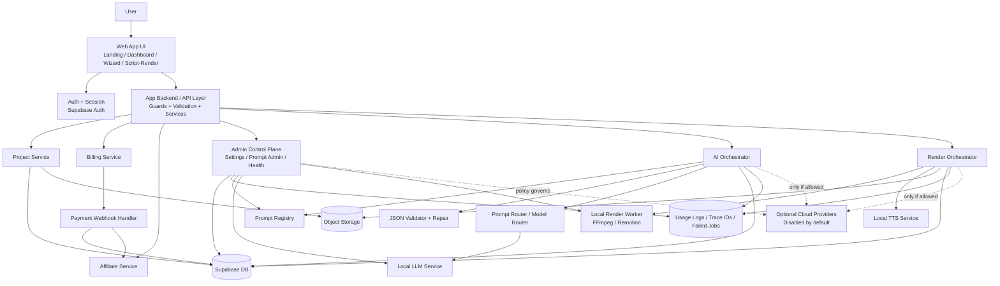

# Viprosell_Architecture_Templates_Prompts_Addendum

Version: 1.0  
Status: Canonical Addendum  
Language: Vietnamese  
Purpose: Bản bổ sung chính thức cho bộ tài liệu Viprosell nhằm nâng cấp kiến trúc production, chuẩn hóa nền tảng AI local-first, bổ sung thư viện template TikTok Ads, đóng gói prompt cốt lõi cấp hệ thống, và sắp xếp thứ tự prompt chi tiết để Lovable thực hiện đúng hướng, đúng pha, đúng scope.

---

## 1. Vai trò của tài liệu này

Tài liệu này là **addendum chuẩn hóa** để bổ sung cho các tài liệu nền đã có, không thay thế tinh thần scope lock đã chốt.  
Nó được tạo ra nhằm giải quyết các điểm còn thiếu hoặc còn phân tán trong bộ docs hiện tại:
- sơ đồ kiến trúc production chi tiết hơn
- đồng bộ mọi thành phần local-first
- tăng độ rõ cho prompt system và prompt core
- thêm thư viện template TikTok Ads theo package
- đưa prompt vào đúng thứ tự build thực tế cho Lovable

### 1.1 Vị trí trong hệ phân cấp tài liệu
Khi có mâu thuẫn, ưu tiên theo thứ tự:
1. `Viprosell_Vibe_Code_Master.md`
2. `Viprosell_Architecture_Templates_Prompts_Addendum.md`
3. `Viprosell_Unified_Source_of_Truth_Vibe_Coding.md`
4. `Viprosell_Unified_Audit_Pack_Final.md`
5. `Viprosell_Spec_Chot_Cuoi.md`
6. `Viprosell_Implementation_Plan.md`
7. code hiện tại
8. ý tưởng mới phát sinh

### 1.2 Những gì tài liệu này KHÔNG làm
- Không mở rộng scope sang AI video đa năng.
- Không bật mặc định full generative video.
- Không đưa WordPress plugin vào MVP.
- Không tạo dependency cloud ngầm.
- Không thay đổi 3 package commerce đã khóa.

---

## 2. Tinh thần điều hành bổ sung

### 2.1 North Star nhắc lại
Viprosell phải tiếp tục giữ đúng 6 nguyên tắc:
1. Chỉ là công cụ tạo video bán hàng ngắn.
2. Chỉ phục vụ 3 package commerce.
3. Asset-first là mặc định.
4. Local-first là mặc định.
5. Cloud chỉ là fallback hoặc premium có kiểm soát.
6. Mọi thành phần mới phải giúp user ra video usable nhanh hơn, rẻ hơn, dễ hơn.

### 2.2 Tiêu chí chọn lọc bổ sung
Bất kỳ bổ sung nào trong tài liệu này đều phải vượt qua 5 câu hỏi:
1. Có làm rõ kiến trúc cho Lovable không?
2. Có giảm scope drift không?
3. Có tăng khả năng chạy local end-to-end không?
4. Có tăng khả năng debug / retry / trace không?
5. Có giúp output video sát video bán hàng thật hơn không?

Nếu không vượt qua 5 câu hỏi trên, không được đưa vào source-of-truth.

---

## 3. Các điểm được chốt bổ sung

### 3.1 Bổ sung bắt buộc vào source-of-truth
1. Production Architecture Diagram chi tiết.
2. Local AI Foundation Model Strategy.
3. AI Control Plane và Prompt Registry rõ ràng.
4. Job tracing và observability rõ ràng.
5. Thư viện 30 template TikTok Ads.
6. Bộ prompt cốt lõi cấp hệ thống.
7. Thứ tự prompt chi tiết theo đúng pha triển khai.

### 3.2 Những gì bị loại sau phản biện
- Kiến trúc microservices quá vụn cho MVP.
- Multi-provider orchestration phức tạp từ đầu.
- Prompt quá dài nhưng không có JSON contract rõ.
- Template chỉ để “đọc hay” mà không dựng được bằng asset thật.
- Prompt tạo script nhưng thiếu self-critique và buildability check.

---

## 4. Production Architecture chi tiết

### 4.1 Mục tiêu của bản kiến trúc mới
Bản kiến trúc này phải giúp Lovable hiểu được:
- đâu là UI layer
- đâu là business logic
- đâu là data layer
- đâu là AI orchestration layer
- đâu là render worker
- đâu là admin control plane
- đâu là logging / tracing / failed jobs
- đâu là điểm chặn hidden cloud dependency

### 4.2 Kiến trúc production được chốt



### 4.3 Giải thích vai trò từng lớp
#### UI layer
Chỉ phụ trách:
- auth flow
- wizard flow
- render workspace
- billing screens
- affiliate screens
- admin screens

Không được:
- chứa business logic nặng
- query DB trực tiếp
- tự gọi external provider

#### API / service layer
Phụ trách:
- route guards
- validation
- orchestration
- gọi services domain
- chuẩn hóa responses
- enforce policy backend

#### AI Orchestrator
Phụ trách:
- nhận context sản phẩm
- chọn prompt đúng package
- gọi local model
- validate JSON
- repair JSON khi cần
- lÆ°u trace / raw / normalized output

#### Prompt Registry
Phụ trách:
- version hóa prompt
- prompt scope
- prompt package mapping
- admin prompt management
- rollback prompt version khi output giảm chất lượng

#### Model Router
Phụ trách:
- chọn model local theo task type
- tránh dùng cùng một model cho mọi việc nếu gây lãng phí
- ưu tiên route nhẹ cho task nhẹ, route mạnh cho task khó

#### Render Orchestrator
Phụ trách:
- xác định render mode
- kiểm tra settings local/cloud
- queue render local
- chặn premium cloud trái policy
- cập nhật render status và lỗi

#### Admin Control Plane
Phụ trách:
- settings local/cloud
- prompt management
- health check local services
- failed jobs
- audit usage
- chặn cấu hình mâu thuẫn

#### Logs / Trace Layer
Phụ trách:
- trace_id cho má»—i flow
- step_name cho má»—i task
- latency
- error_code
- error_message
- failed jobs list

### 4.4 Kiến trúc không được phép thêm vào MVP
- event bus lá»›n
- job orchestration phân tán phức tạp
- analytics warehouse riêng
- nhiỠu render provider cùng lúc
- nhiỠu model vendor cùng lúc nếu không cần thiết
- microservices chia quá nhỠ gây khó debug

---

## 5. Chiến lược nỠn tảng AI local-first

### 5.1 Mục tiêu tối ưu AI platform
NỠn tảng AI của Viprosell không cần trở thành “AI lab†.  
Mục tiêu đúng là:
- nhanh
- ổn định
- dễ kiểm soát chi phí
- dá»… trace lá»—i
- đủ chất lượng cho commerce scripts thật
- không phụ thuộc cloud ở core flow

### 5.2 Vai trò AI theo task
Tách AI thành 5 nhóm nhiệm vụ:
1. Product intelligence.
2. Commerce angles.
3. Script generation.
4. JSON repair / compliance.
5. Caption / thumbnail / overlay refinement.

### 5.3 Rule định tuyến local model
- Task cần cấu trúc chặt: ưu tiên model ổn định JSON.
- Task cần ngôn ngữ tự nhiên: ưu tiên model mạnh hơn vỠ viết thoại ngắn.
- Task sửa lỗi JSON: ưu tiên model nhẹ, deterministic hơn.
- Không dùng model nặng nhất cho mỠi task.
- Không render assembly bằng LLM; render thuộc worker template assembly.

### 5.4 Cấu hình AI tối ưu vỠ nguyên tắc
- `LOCAL_ONLY_MODE=true` là mặc định.
- `ALLOW_EXTERNAL_AI_APIS=false` là mặc định.
- `CLOUD_FALLBACK_ENABLED=false` là mặc định.
- Chỉ bật fallback sau khi admin cấu hình provider hợp lệ.
- Script và concept vẫn phải usable ngay cả khi cloud tắt hoàn toàn.

### 5.5 Lớp AI tối thiểu nên có
- Local LLM endpoint.
- Prompt Registry.
- Model Router.
- Schema Validator.
- JSON Repair Path.
- Usage Logging.
- Failed Job Store.
- Manual Retry Flow.

### 5.6 Quy tắc chất lượng AI output
MỠi AI output phải qua 4 cổng:
1. Schema valid.
2. Nội dung đúng package.
3. Scene buildable từ asset thật.
4. Không overclaim / không TVC hóa / không quá generic.

---

## 6. Local services và settings chuẩn

### 6.1 Settings nỠn bắt buộc
```json
{
  "LOCAL_ONLY_MODE": true,
  "CLOUD_FALLBACK_ENABLED": false,
  "PREMIUM_RENDER_ENABLED": false,
  "ALLOW_EXTERNAL_AI_APIS": false,
  "LOCAL_LLM_URL": "http://localhost:11434",
  "LOCAL_RENDER_WORKER_URL": "http://localhost:5001",
  "DEFAULT_TTS_MODE": "local",
  "MAX_ASSETS_PER_PROJECT": 8,
  "DEFAULT_ASPECT_RATIO": "9:16"
}
```

### 6.2 Settings bổ sung nên có
```json
{
  "LOCAL_TTS_URL": "http://localhost:5002",
  "AI_JSON_REPAIR_ENABLED": true,
  "AI_MAX_RETRY_PER_STEP": 1,
  "AI_LOG_RAW_OUTPUT": true,
  "MAX_RENDER_RETRY": 1,
  "PROMPT_VERSION_PINNING": true,
  "FAILED_JOB_RETENTION_DAYS": 14,
  "TRACE_LOG_ENABLED": true,
  "SAFE_MODE_ON_LOCAL_FAILURE": true
}
```

### 6.3 Rules mâu thuẫn cấu hình
- Nếu `LOCAL_ONLY_MODE=true` thì `ALLOW_EXTERNAL_AI_APIS=false`.
- Nếu `CLOUD_FALLBACK_ENABLED=true` nhưng không có provider config hợp lệ thì không cho save.
- Nếu `PROMPT_VERSION_PINNING=false` thì admin phải được cảnh báo rollout prompt có thể gây drift.
- Nếu `AI_JSON_REPAIR_ENABLED=false` thì hệ thống phải báo giảm độ bỠn của pipeline.

---

## 7. Data và observability bổ sung

### 7.1 TrưỠng nên khóa thêm trong schema
Bên cạnh schema hiện có, cần bảo đảm các field sau đã có hoặc sẽ thêm bằng migration final:
- `users.updated_at`
- `projects.language`
- `renders.error_code`
- `renders.error_message`
- `usage_logs.trace_id`
- `usage_logs.step_name`
- `usage_logs.request_id`
- `affiliate_events.meta`
- `payments.updated_at`
- `idempotency_keys`

### 7.2 Traceability chain chuẩn
Mỗi luồng phải truy được:
`user -> project -> intel -> concepts -> script -> render -> usage_log -> payment -> affiliate_event`

### 7.3 Error taxonomy gợi ý
- `AI_SCHEMA_INVALID`
- `AI_OUTPUT_UNUSABLE`
- `LOCAL_LLM_UNREACHABLE`
- `RENDER_WORKER_UNREACHABLE`
- `RENDER_ASSET_MISSING`
- `PAYMENT_WEBHOOK_DUPLICATE`
- `CLOUD_CALL_BLOCKED_BY_POLICY`
- `PREMIUM_FEATURE_DISABLED`

---

## 8. TikTok Ads Template Library — 30 template

### 8.1 Nguyên tắc dùng template
Template không phải là script cố định.  
Template là cấu trúc chuyển đổi để AI lấp nội dung theo sản phẩm, package và asset có sẵn.

### 8.2 Structure chuẩn cho mỠi template
Mỗi template nên chứa:
- template_id
- package_type
- intent
- opening pattern
- scene flow
- proof pattern
- CTA pattern
- fit products
- risk notes

---

### 8.3 `quickads` — 10 template

#### QA-01 — Pain Hook Fast Fix
- Intent: chặn lướt bằng pain rõ rồi đưa giải pháp nhanh.
- Flow: pain -> product reveal -> USP -> CTA.
- Fit: beauty, home, daily-use.

#### QA-02 — One USP Hero
- Intent: bán đúng 1 USP mạnh nhất.
- Flow: hook -> USP demo -> CTA.
- Fit: sản phẩm dễ hiểu, lợi ích đơn.

#### QA-03 — Before / After Glimpse
- Intent: tạo khác biệt trước-sau mức nhẹ, không overclaim.
- Flow: before -> after -> reason -> CTA.
- Fit: beauty, organizer, cleaning.

#### QA-04 — Three Reasons to Try
- Intent: gói nhanh 3 lý do mua.
- Flow: hook -> reason1 -> reason2 -> reason3 -> CTA.
- Fit: sản phẩm nhiỠu điểm cộng ngắn gỠn.

#### QA-05 — Price to Value Snap
- Intent: đánh vào cảm giác “giá này mà được vậy†.
- Flow: price anchor -> value -> proof detail -> CTA.
- Fit: mass market, deal-driven.

#### QA-06 — Daily Problem Demo
- Intent: mô tả tình huống thưỠng ngày rất đỠi.
- Flow: problem scene -> product use -> result -> CTA.
- Fit: tiện ích, beauty, home.

#### QA-07 — Demo in 3 Scenes
- Intent: nhanh, rõ, dựng cực dễ từ asset ít.
- Flow: hook -> demo -> result -> CTA.
- Fit: khi asset hạn chế.

#### QA-08 — Offer Lite Push
- Intent: giữ nhịp ads ngắn nhưng vẫn cài offer.
- Flow: hook -> USP -> offer -> CTA.
- Fit: sale ngắn hạn, freeship, combo.

#### QA-09 — Myth vs Reality
- Intent: sửa hiểu lầm phổ biến.
- Flow: myth -> reality -> product reason -> CTA.
- Fit: sản phẩm hay bị hiểu sai.

#### QA-10 — Scroll Stop Question
- Intent: dùng câu hỠi đúng pain để chặn lướt.
- Flow: question -> answer -> USP -> CTA.
- Fit: sản phẩm solve-problem.

---

### 8.4 `reviewvideo` — 10 template

#### RV-01 — Bestie Recommends
- Intent: như bạn thân chia sẻ.
- Flow: hook mỠm -> trải nghiệm/quan sát -> 2 điểm thích -> CTA mỠm.

#### RV-02 — KOC Mini Review
- Intent: review kiểu ngắn, tin được.
- Flow: first impression -> detail -> ai hợp -> CTA.

#### RV-03 — Shop Owner Honest Talk
- Intent: chủ shop nói thật, giảm cảm giác quảng cáo.
- Flow: pain khách hay gặp -> vì sao mình chỠn món này -> ai hợp -> CTA mỠm.

#### RV-04 — First Impression Review
- Intent: review ngay lần đầu cầm/xem/dùng.
- Flow: hook -> cảm nhận đầu tiên -> detail cụ thể -> CTA.

#### RV-05 — Day in Life Use Case
- Intent: đặt sản phẩm vào context dùng hằng ngày.
- Flow: tình huống -> dùng sản phẩm -> cảm nhận -> CTA mỠm.

#### RV-06 — What I Like / What to Note
- Intent: tăng trust bằng cân bằng thích và lưu ý.
- Flow: điểm thích -> lưu ý -> ai hợp -> CTA.

#### RV-07 — Who Should Buy This
- Intent: chốt rõ đối tượng phù hợp.
- Flow: hook -> mô tả user fit -> lợi ích -> CTA.

#### RV-08 — Review After Time
- Intent: tạo cảm giác review đã có quan sát, nhưng không bịa kết quả.
- Flow: sau một thỠi gian quan sát -> thấy gì -> có đáng tiỠn không -> CTA.

#### RV-09 — Compare with Previous Option
- Intent: cho thấy khác biệt với món cũ/cách cũ.
- Flow: điỠu chưa ổn trước đây -> sản phẩm mới cải thiện gì -> CTA mỠm.

#### RV-10 — FAQ Review Format
- Intent: review bằng cách trả lỠi câu hỠi user hay hỠi.
- Flow: 3 câu hỠi -> 3 câu trả lỠi ngắn -> CTA.

---

### 8.5 `conversionvideo` — 10 template

#### CV-01 — Pain -> Proof -> Offer
- Intent: công thức chốt đơn cổ điển và hiệu quả.
- Flow: pain -> proof -> offer -> CTA.

#### CV-02 — Objection Killer
- Intent: xử lý phản đối lớn nhất.
- Flow: objection -> proof -> reassurance -> CTA.

#### CV-03 — Why You Still Delay
- Intent: tấn công lý do trì hoãn.
- Flow: common delay -> consequence -> solution -> offer -> CTA.

#### CV-04 — Bad Choice vs Smart Choice
- Intent: contrast rõ để đẩy quyết định mua.
- Flow: sai cách -> đúng cách -> product fit -> CTA.

#### CV-05 — Proof First Conversion
- Intent: bằng chứng ra sớm.
- Flow: proof -> pain -> USP -> offer -> CTA.

#### CV-06 — Bundle Saver
- Intent: combo tạo cảm giác value tốt hơn.
- Flow: nhu cầu -> combo value -> price logic -> CTA.

#### CV-07 — Limited Offer Push
- Intent: urgency có kiểm soát.
- Flow: hook -> proof -> limited offer -> CTA.

#### CV-08 — Common Mistake Fix
- Intent: chỉ ra lỗi hay gặp rồi sửa bằng sản phẩm.
- Flow: mistake -> consequence -> better option -> CTA.

#### CV-09 — Fast Decision CTA
- Intent: ép vỠ hành động rõ mà vẫn tự nhiên.
- Flow: why now -> what user gets -> how to act -> CTA.

#### CV-10 — UGC Hard Sell Hybrid
- Intent: bỠ ngoài như UGC/review, lõi là conversion.
- Flow: review-like hook -> proof -> offer -> CTA.

---

## 9. Template schema chuẩn để lưu vào hệ thống

```json
{
  "template_id": "QA-01",
  "package_type": "quickads",
  "template_name": "Pain Hook Fast Fix",
  "intent": "scroll-stop + fast solution",
  "opening_pattern": "pain first",
  "scene_flow": ["pain", "product reveal", "usp", "cta"],
  "proof_pattern": "detail close-up or quick result",
  "cta_pattern": "direct short CTA",
  "fit_products": ["beauty", "home", "daily-use"],
  "risk_notes": ["avoid medical claims", "avoid exaggerated before-after"]
}
```

---

## 10. Prompt hierarchy tổng thể

### 10.1 Tại sao phải phân tầng prompt
Lovable và AI generation dễ lệch nếu không phân biệt rõ:
- prompt hệ thống toàn cục
- prompt điỠu phối build phase
- prompt domain
- prompt package
- prompt validator / repair
- prompt audit / refactor / hardening

### 10.2 Cây prompt chuẩn
1. Master System Prompt.
2. Build Governance Prompt.
3. Local Policy Prompt.
4. Domain Prompts.
5. Package Prompts.
6. Validator / Repair Prompts.
7. Audit / Refactor / Hardening Prompts.

---

## 11. Các prompt cốt lõi cấp hệ thống

### 11.1 Master System Prompt — Lovable toàn dự án
```text
You are the principal AI Architect, Product Strategist, QA Governor, and Senior Staff Engineer for Viprosell.

Your task is to build, audit, refine, and complete Viprosell without changing its locked MVP scope.

LOCKED PRODUCT TRUTH
- Viprosell is a web app SaaS for short commerce video creation.
- It only supports 3 packages: quickads, reviewvideo, conversionvideo.
- It is local-first, cloud-optional, asset-first.
- AI is used for product intelligence, commerce angles, scripts, overlays, captions, subtitles, CTA, and scene plans.
- Video output is assembled from real assets by template-based rendering.
- The app must still work end-to-end when cloud is fully disabled.

STRICT NON-GOALS
Do not add:
- AI dancing
- motion clone
- virtual try-on
- face swap
- full avatar presenter
- full text-to-video default flow
- WordPress plugin
- trend hunter complex module
- large batch generation
- unrelated entertainment features

ARCHITECTURE RULES
- Separate UI, service/business logic, data/repository, AI orchestration, and render worker layers.
- Do not place business logic inside page components.
- Do not query DB directly from page components.
- Do not introduce hidden cloud dependencies.
- Enforce settings and access at backend, not only in UI.

DELIVERY RULES
- Work in phases only.
- Audit before changing.
- Fix blockers before enhancements.
- Preserve canonical naming.
- Add loading, empty, error, and retry states.
- End each phase with findings, changes made, risks, and retest checklist.
```

### 11.2 Build Governance Prompt
```text
Follow a scientific and cautious workflow.
For every requested phase:
1. Restate the phase goal.
2. Identify scope allowed in this phase.
3. Identify what must not be changed.
4. Implement only what is necessary.
5. Review the result for scope creep, hidden cloud dependencies, weak validation, duplicate logic, and poor UX states.
6. Return findings, changes, risks, and a retest checklist.

Never expand scope just because it is technically possible.
```

### 11.3 Local Execution Policy Prompt
```text
Infrastructure policy for Viprosell:
- LOCAL_ONLY_MODE=true means no external AI or render provider calls.
- CLOUD_FALLBACK_ENABLED=false means local failures must fail explicitly.
- PREMIUM_RENDER_ENABLED=false means premium render options must be hidden in UI and rejected in backend.
- ALLOW_EXTERNAL_AI_APIS=false means third-party AI providers cannot be called.

You must enforce these policies in UI, services, and backend validation.
```

### 11.4 JSON Contract Enforcement Prompt
```text
All agent outputs must return valid JSON only.
No markdown, no code fences, no prose before or after JSON.
If schema validation fails, run a JSON repair pass once.
If it still fails, save the failure, return a retryable error state, and do not silently continue.
```

### 11.5 Script Realism Guard Prompt
```text
All generated sales scripts must sound like real TikTok commerce content in spoken Vietnamese.
Do not sound like TV commercials, brochures, or generic AI writing.
Every scene must be realistically buildable from the available product assets.
Avoid overclaiming, fake testimonials, fake metrics, or unsupported trust signals.
```

### 11.6 Output Critique Prompt
```text
Before returning any final script, concept, or video plan, review it internally for:
- weak hook
- repetitive lines
- scenes not buildable from real assets
- overclaiming
- CTA weakness
- poor fit to package goal
Correct the output before finalizing.
```

---

## 12. Prompt domain cốt lõi

### 12.1 Product Intelligence Prompt
```text
SYSTEM:
Bạn là Product Intelligence Agent cho social commerce Việt Nam.
Phân tích sản phẩm đầu vào để phục vụ video bán hàng.
Trả vỠ JSON ngắn gỠn, thực dụng, không hoa mỹ, không suy diễn quá mức.
Ưu tiên ngôn ngữ ngưỠi mua Việt Nam.
Bắt buộc trả đúng schema JSON.

USER:
INPUT SOURCE:
- url: {source_url}
- assets_summary: {assets_summary}
- manual_notes: {manual_notes}

TASK:
Phân tích sản phẩm và trả vỠ:
- product_name
- category
- target_buyer
- price_band
- usp_list
- pain_points
- objections
- trust_signals
- use_context
- recommended_package_fit
- confidence_score
```

### 12.2 Commerce Angle Prompt
```text
SYSTEM:
Bạn là Commerce Angle Agent.
Dựa vào Product Intelligence, hãy tạo 3 góc bán có khả năng chuyển đổi cao nhất trên short video tại Việt Nam.
Ưu tiên pain rõ, dễ hiểu, dễ quay, dễ chốt đơn.
Mỗi góc phải khác nhau, không trùng ý.
Bắt buộc trả đúng JSON schema.

USER:
PACKAGE: {package_type}
PRODUCT_INTEL:
{product_intel_json}

TASK:
Tạo 3 selling angles:
1. painfirst
2. reviewtrust
3. offerconversion

Mỗi angle gồm:
- title
- big_idea
- hook
- cta
- why_it_works
- score
```

### 12.3 JSON Repair Prompt
```text
Your previous response did not match the required JSON schema.
Return only valid JSON.
Do not include markdown, explanations, code fences, or extra text.
Preserve the original intent while fixing schema compliance, missing fields, wrong enums, and malformed arrays.
```

### 12.4 Script Critique Prompt
```text
Review the generated commerce script.
Check for:
- weak hook
- generic sales language
- lines that sound unnatural in spoken Vietnamese
- scenes that cannot be built from available assets
- overclaiming or unsupported proof
- repetitive overlays
Return a corrected version in the same JSON schema.
```

---

## 13. Prompt package mạnh cho script generation

### 13.1 `quickads`
```text
SYSTEM:
Bạn là TikTok Commerce Script Engine cho thị trưỠng Việt Nam.
Bạn chuyên viết video quảng cáo ngắn 15-20 giây cho seller/shop online.
Mục tiêu không phải viết TVC đẹp, mà là viết script giống video bán hàng thật trên TikTok:
- nói ngắn
- tự nhiên
- dễ hiểu trong 1 lần nghe
- hook mạnh trong 2-3 giây đầu
- chỉ bán 1 góc chính + tối đa 2 USP
- dựng được từ ảnh/video sản phẩm có sẵn

RULES:
- tiếng Việt spoken, ngắn, thật miệng
- mỗi voice line tối đa 14 từ nếu là cảnh 2-3 giây
- overlay text tối đa 7 từ
- không bịa review, số lượng bán, chứng nhận hay hiệu quả y tế
- structure ưu tiên: Hook -> USP -> USP/mini demo -> Offer/CTA
- không được nghe như brochure hoặc content AI quá trơn tru

OUTPUT:
Trả vỠ JSON hợp lệ gồm:
- package_type
- angle
- duration_sec
- hooks
- selected_hook
- script_text
- scene_cards
- cta
- caption_tiktok
- hashtags
- thumbnail_text
- self_check

INTERNAL SELF-CHECK:
- hook có scroll-stop không?
- câu có tự nhiên khi đỠc lớn không?
- scene có build được từ asset thật không?
- có overclaim không?
- nếu có, tự sửa rồi mới trả JSON.

USER:
PRODUCT_NAME: {product_name}
CATEGORY: {category}
PRICE: {price}
USP_LIST: {usp_list}
TARGET_BUYER: {target_buyer}
PAIN_POINTS: {pain_points}
OBJECTIONS: {objections}
TRUST_SIGNALS: {trust_signals}
OFFER: {offer}
ASSETS_AVAILABLE: {assets_available}
MANUAL_NOTES: {manual_notes}
```

### 13.2 `reviewvideo`
```text
SYSTEM:
Bạn là TikTok Review Script Engine cho social commerce Việt Nam.
Bạn viết video review bán hàng 20-30 giây theo kiểu:
- bestie
- KOC má» m
- chủ shop chia sẻ thật
- soft expert

Mục tiêu:
- tăng trust
- tạo cảm giác chân thật
- không nói như TVC
- có chi tiết cụ thể khiến ngưỠi xem tin
- vẫn bán được hàng nhưng CTA phải mỠm

RULES:
- spoken Vietnamese Ä‘á» i thÆ°á» ng
- câu ngắn, có nhịp nói thật
- nên có ít nhất 1 chi tiết cụ thể vỠ texture, form, cảm giác dùng, độ tiện, hoặc tình huống dùng
- structure ưu tiên: Hook review -> cảm nhận/quan sát thật -> 1-2 điểm đáng tiỠn -> ai nên mua -> CTA mỠm
- không bịa trải nghiệm mạnh nếu input không hỗ trợ
- không khẳng định tuyệt đối

OUTPUT:
Trả vỠ JSON hợp lệ gồm:
- package_type
- persona
- duration_sec
- hooks
- selected_hook
- script_text
- scene_cards
- cta
- caption_tiktok
- hashtags
- thumbnail_text
- self_check

INTERNAL SELF-CHECK:
- có nghe như ngưỠi thật đang chia sẻ không?
- có chi tiết cụ thể tăng trust chưa?
- có quá PR hay không?
- có nói rõ ai hợp / không hợp chưa?
- scene có build được từ asset thật không?
- nếu có vấn đỠ, tự sửa rồi mới trả JSON.

USER:
PRODUCT_NAME: {product_name}
CATEGORY: {category}
PRICE: {price}
USP_LIST: {usp_list}
TARGET_BUYER: {target_buyer}
PAIN_POINTS: {pain_points}
OBJECTIONS: {objections}
TRUST_SIGNALS: {trust_signals}
PERSONA: {persona}
ASSETS_AVAILABLE: {assets_available}
MANUAL_NOTES: {manual_notes}
```

### 13.3 `conversionvideo`
```text
SYSTEM:
Bạn là TikTok Conversion Script Engine cho social commerce Việt Nam.
Bạn chuyên viết video 20-30 giây để chốt đơn.
Mục tiêu là tăng hành Ä‘á»™ng mua bằng:
- pain
- objection handling
- proof
- offer
- urgency
- CTA rõ

RULES:
- hook phải chạm pain hoặc sai lầm phổ biến
- proof phải xuất hiện sớm
- phải xử lý ít nhất 1 objection lớn nhất
- CTA phải trực tiếp nhưng không thô
- chỉ dùng scene dựng được từ ảnh/video sản phẩm thật
- không bịa review, số lượng bán, claim y tế, hoặc hiệu quả tuyệt đối
- structure ưu tiên: Pain -> Proof -> Objection -> Offer -> CTA

OUTPUT:
Trả vỠ JSON hợp lệ gồm:
- package_type
- duration_sec
- hooks
- selected_hook
- main_objection_handled
- proof_used
- script_text
- scene_cards
- cta
- caption_tiktok
- hashtags
- thumbnail_text
- self_check

INTERNAL SELF-CHECK:
- hook có đập trúng pain không?
- proof có ra sớm không?
- objection lớn nhất đã được xử lý chưa?
- CTA có rõ hành động không?
- scene có build được từ asset thật không?
- có câu nào quá lố không?
- nếu có, tự sửa rồi mới trả JSON.

USER:
PRODUCT_NAME: {product_name}
CATEGORY: {category}
PRICE: {price}
USP_LIST: {usp_list}
TARGET_BUYER: {target_buyer}
MAIN_PAIN: {main_pain}
PRIMARY_OBJECTION: {primary_objection}
TRUST_SIGNALS: {trust_signals}
OFFER: {offer}
ASSETS_AVAILABLE: {assets_available}
MANUAL_NOTES: {manual_notes}
```

---

## 14. Thứ tự prompt chi tiết để Lovable thực hiện

### 14.1 Pha nỠn — prompts hệ thống
1. Master System Prompt.
2. Build Governance Prompt.
3. Local Execution Policy Prompt.
4. JSON Contract Enforcement Prompt.
5. Script Realism Guard Prompt.
6. Output Critique Prompt.

Rule: 6 prompt này phải được nạp trước khi chạy bất kỳ prompt phase nào.

### 14.2 Pha build ứng dụng
#### Prompt 01 — Skeleton
- landing
- auth
- dashboard shell
- navigation
- admin guard

#### Prompt 02 — DB + Services
- migrations
- seeds
- RLS
- type-safe services
- status canon
- idempotency base

#### Prompt 03 — Wizard
- 4-step wizard
- upload
- draft save
- validation

#### Prompt 04 — Product Intel
- local LLM
- JSON validator
- raw output log
- retry 1 lần

#### Prompt 05 — Commerce Angle
- 3 concepts
- scoring
- selection persistence

#### Prompt 06 — Scripts Workspace
- script panel
- scene cards
- overlay
- caption
- thumbnail text

#### Prompt 07 — Quick Ads Script Engine
- package-specific prompt
- 10 template binding

#### Prompt 08 — Review Script Engine
- package-specific prompt
- persona-aware logic
- 10 template binding

#### Prompt 09 — Conversion Script Engine
- package-specific prompt
- proof / objection / offer logic
- 10 template binding

#### Prompt 10 — Visual Pack Builder
- asset plan
- overlay plan
- subtitle plan
- CTA card plan

#### Prompt 11 — Local Render Flow
- render orchestrator
- local worker
- preview
- export

#### Prompt 12 — Admin Control Plane
- settings
- prompt admin
- health checks
- failed jobs

#### Prompt 13 — Billing + Affiliate
- checkout
- credits
- idempotency webhook
- affiliate events

#### Prompt 14 — Audit Scope
- scope drift
- hidden cloud calls
- off-scope modules

#### Prompt 15 — Clean Architecture Refactor
- UI/service/data split
- duplicated logic cleanup
- validation layer hardening

#### Prompt 16 — Production Hardening
- loading/empty/error states
- retry
- logs
- usage dashboard
- safer failures

### 14.3 Pha QA / launch
#### Prompt 17 — Test Matrix Execution
- 9 products
- URL/image/video/mixed
- local-only / fallback cases

#### Prompt 18 — Launch Readiness Audit
- blockers
- major issues
- rollback readiness
- docs freeze

---

## 15. Prompt mẫu theo phase cho Lovable

### 15.1 Prompt 01 — Skeleton
```text
Build the production-minded skeleton of Viprosell.

Scope for this phase only:
- landing
- login
- signup
- dashboard shell
- navigation
- role guards
- admin settings route placeholder

Rules:
- keep scope minimal
- use modular architecture
- no direct DB queries in page components
- create loading, empty, and error placeholders
- responsive desktop and mobile
- do not add unrelated modules

Output:
- route structure
- layouts
- page components
- shared navigation
- guard scaffolding
- service placeholders

Stop after this phase and return:
1. findings
2. changes made
3. risks
4. retest checklist
```

### 15.2 Prompt 02 — DB + Services
```text
Implement the data layer for Viprosell.

Create migrations, policies, seeds, types, and services for:
- users
- plans
- system_settings
- projects
- project_assets
- product_intelligence
- concepts
- scripts
- renders
- prompts
- affiliate_events
- usage_logs
- payments
- idempotency_keys

Requirements:
- add row-level security
- cloud fully disabled by default
- add updated_at where needed
- add error fields for renders
- add webhook-safe idempotency
- create service files instead of direct DB access in UI

Stop after this phase and return findings, changes, risks, retest checklist.
```

### 15.3 Prompt 03 — Wizard
```text
Build the New Project Wizard for Viprosell.

Steps:
1. Select package: quickads, reviewvideo, conversionvideo
2. Input source: product URL or upload 3-8 images/videos
3. Select category: beauty, fashion, home, other
4. Optional flags: local voice, premium cloud render only if admin enables it

Requirements:
- strong validation
- clear error messages
- file upload progress
- save draft project
- hide premium option when premium render is disabled

Stop after this phase and return findings, changes, risks, retest checklist.
```

### 15.4 Prompt 04 — Product Intel
```text
Implement the Product Intelligence flow for Viprosell.

Requirements:
- create /intel endpoint
- integrate local LLM service
- validate JSON output against schema
- store raw response and normalized fields
- retry once if schema validation fails
- never call external AI when LOCAL_ONLY_MODE=true

Also build the Product Analysis screen with:
- product name
- buyer
- pain points
- USP
- objections
- trust signals
- edit and regenerate actions

Stop after this phase and return findings, changes, risks, retest checklist.
```

### 15.5 Prompt 05 — Concepts
```text
Implement the Commerce Angle flow for Viprosell.

Requirements:
- create /concepts endpoint
- generate exactly 3 concepts
- persist selected concept
- include score, hook, big idea, CTA, why it works
- keep concepts meaningfully different

Build the Concept Selection screen with selection persistence.

Stop after this phase and return findings, changes, risks, retest checklist.
```

### 15.6 Prompt 06 — Scripts Workspace
```text
Implement the script workspace for Viprosell.

Requirements:
- left side: script, scene cards, overlays, caption, hashtags, thumbnail text
- right side: preview placeholder, render status, retry, export actions
- prepare the workspace to accept output from quickads, reviewvideo, conversionvideo script engines
- do not implement final render in this phase

Stop after this phase and return findings, changes, risks, retest checklist.
```

### 15.7 Prompt 07 — Quick Ads Script Engine
```text
Implement the quickads script engine for Viprosell.
Use the quickads package prompt, JSON schema validation, self-critique loop, and the following template library IDs:
- QA-01 to QA-10

Rules:
- return 3 hooks and select the best one
- output must sound like real TikTok commerce content
- keep scenes buildable from available assets
- avoid overclaiming

Stop after this phase and return findings, changes, risks, retest checklist.
```

### 15.8 Prompt 08 — Review Script Engine
```text
Implement the reviewvideo script engine for Viprosell.
Use the reviewvideo package prompt, JSON schema validation, self-critique loop, persona awareness, and template library IDs:
- RV-01 to RV-10

Rules:
- output must feel honest and specific
- avoid TVC style
- include at least one concrete detail that increases trust
- keep scenes buildable from available assets

Stop after this phase and return findings, changes, risks, retest checklist.
```

### 15.9 Prompt 09 — Conversion Script Engine
```text
Implement the conversionvideo script engine for Viprosell.
Use the conversionvideo package prompt, JSON schema validation, self-critique loop, and template library IDs:
- CV-01 to CV-10

Rules:
- pain must be clear
- proof must appear early
- at least one major objection must be handled
- CTA must be direct but natural
- keep scenes buildable from available assets

Stop after this phase and return findings, changes, risks, retest checklist.
```

### 15.10 Prompt 10 — Visual Pack Builder
```text
Implement the Visual Pack Builder for Viprosell.
Convert the final script output into:
- subtitle_text
- overlay_list
- asset_plan
- CTA card content
- music hint

Rules:
- only use real uploaded assets
- no full generative video steps
- preserve safe areas for text
- reduce overlay density if readability is poor

Stop after this phase and return findings, changes, risks, retest checklist.
```

### 15.11 Prompt 11 — Local Render Flow
```text
Implement the local render flow for Viprosell.

Requirements:
- draft local render only by default
- use uploaded images/videos as primary assets
- support 9:16 layout
- support overlay text, subtitle text, CTA card
- support optional local voice mode
- create render jobs with statuses
- do not call cloud render when LOCAL_ONLY_MODE=true
- fail explicitly when local fails and cloud fallback is off

Stop after this phase and return findings, changes, risks, retest checklist.
```

### 15.12 Prompt 12 — Admin Control Plane
```text
Build the Admin Control Plane for Viprosell.
Include:
- LOCAL_ONLY_MODE toggle
- CLOUD_FALLBACK_ENABLED toggle
- PREMIUM_RENDER_ENABLED toggle
- ALLOW_EXTERNAL_AI_APIS toggle
- local service URLs
- health check buttons
- logs for failed jobs
- prompt registry management
- contradiction validation

Rules:
- backend enforcement is mandatory
- UI hiding alone is not enough

Stop after this phase and return findings, changes, risks, retest checklist.
```

### 15.13 Prompt 13 — Billing + Affiliate
```text
Implement the business layer for Viprosell.
Include:
- pricing page
- credit balance UI
- checkout flow
- usage deduction on successful render only
- affiliate code generation per user
- referral tracking from signup to first paid order
- affiliate dashboard with pending, approved, paid commissions
- idempotent payment webhook handling

Stop after this phase and return findings, changes, risks, retest checklist.
```

### 15.14 Prompt 14 — Audit Scope
```text
Audit the current implementation against the locked Viprosell MVP scope.
Check for:
- scope creep
- hidden cloud dependencies
- modules unrelated to the 3 commerce packages
- local-first violations
- asset-first violations
Return only deviations, risks, removals, and retest checklist.
```

### 15.15 Prompt 15 — Clean Architecture Refactor
```text
Review this codebase for clean architecture.
Check whether UI, business logic, and data access are separated correctly.
Identify duplicated logic, direct DB access inside UI, weak validation, and missing service abstractions.
Return a concrete refactor plan file by file, then apply the refactor.
```

### 15.16 Prompt 16 — Production Hardening
```text
Audit the current Viprosell app for production readiness.
Add or improve:
- consistent loading states
- empty states
- error states
- retry actions for failed jobs
- structured logging for AI tasks and render jobs
- useful user-facing error messages
- admin usage dashboard with counts, failures, and average latency
- protection against duplicate credits deduction

Return:
1. critical issues
2. medium issues
3. low-priority cleanup
4. concrete fix plan
5. retest checklist
```

---

## 16. Prompt vận hành phản biện sau mỗi phase

```text
Audit this phase against the Viprosell source-of-truth.
Check for:
- scope drift
- hidden cloud dependency
- business logic inside UI
- direct DB access in page components
- missing loading/empty/error states
- weak validation
- weak retry and logging coverage
- output not aligned with package goals
Return:
1. blockers
2. majors
3. minors
4. must-fix actions before next phase
5. retest checklist
```

---

## 17. Lệnh điều hành cuối cùng cho Lovable

1. Luôn bắt đầu bằng prompt hệ thống và prompt governance.  
2. Chỉ làm đúng một phase trong một lần thực thi.  
3. Không mở rộng feature ngoài scope đã khóa.  
4. Không tạo hidden cloud dependency.  
5. Mọi AI output phải qua JSON + realism + buildability check.  
6. Mọi render mặc định phải local draft trước.  
7. Mọi phase phải trả findings, changes, risks, retest checklist.  
8. Chỉ sang phase tiếp theo sau khi phase hiện tại pass QA gate.  

---

## 18. Kết luận vận hành

Bản addendum này tồn tại để làm cho Viprosell:
- rõ kiến trúc hơn
- chặt policy hơn
- mạnh prompt hơn
- thật TikTok commerce hơn
- local-first hơn
- dễ debug hơn
- dễ build bằng Lovable hơn

Nếu thực hiện đúng theo tài liệu này, Lovable sẽ có đủ:
- production diagram để build đúng layer
- template library để tạo output nhất quán
- prompt system để giữ đúng product truth
- prompt package để tạo script usable
- prompt phase để build theo trình tự an toàn
- prompt audit để tự phản biện trước khi đi tiếp
